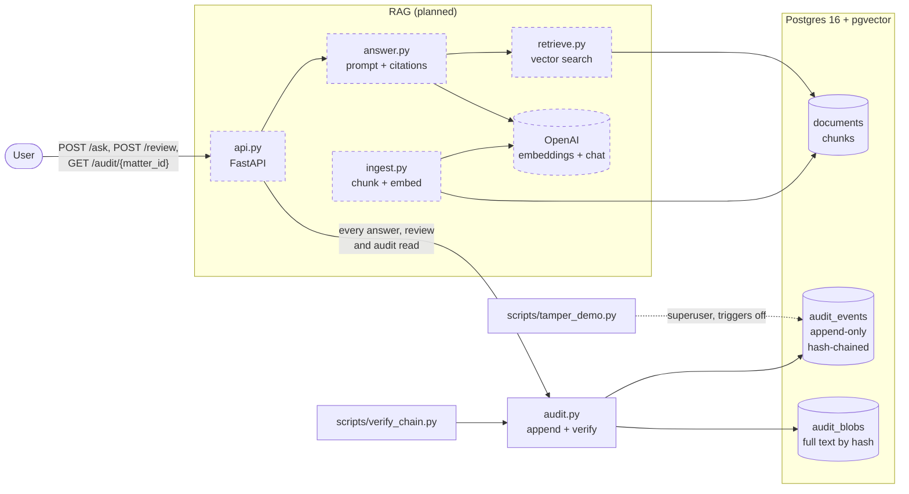
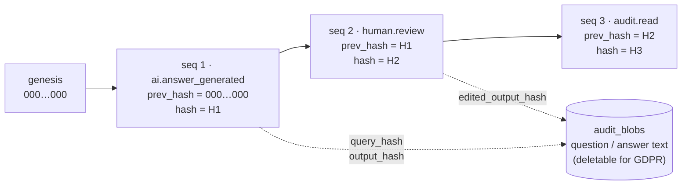
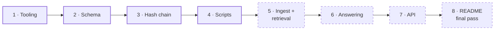

# Auditable RAG Demo

A small demo of how to make a retrieval-augmented generation (RAG) system **auditable** for legal and governance use. The goal is that any AI answer can be reconstructed later: what was asked, which document chunks were used, which model and prompt version produced it, what the user saw, and who reviewed it.

Audit records are append-only and **tamper-evident**: they form a hash chain, and a verifier script reports the first record that was changed, deleted or reordered.

This is a portfolio demo, not production software. See [SPEC.md](SPEC.md) for the full specification.

> **Status: work in progress.** The audit layer is built and tested: the database schema, immutability rules, hash chain, verifier and tamper demo, with 40 tests. The RAG part (ingest, retrieval, answering) and the HTTP API are **not built yet**. See [What's left to do](#whats-left-to-do).

## How it fits together

Solid boxes exist today. Dashed boxes are planned.



### The hash chain

Each event stores the hash of the event before it, and its own hash covers that value plus all of its other columns:

```
hash = sha256(prev_hash || canonical_json(every column except hash))
```



Editing seq 2 means its recomputed hash no longer matches the hash stored with it. Deleting seq 2 leaves seq 3 pointing at a hash that isn't there anymore. Either way, the verifier stops and reports that `seq`.

## Quick start

Requirements: Docker (Desktop or another runtime) and [uv](https://docs.astral.sh/uv/). uv installs Python 3.12 for you.

```bash
cp .env.example .env                  # an OpenAI key is only needed for the RAG part, later
docker compose up -d --wait           # Postgres 16 + pgvector; applies sql/001_schema.sql on first start
uv sync                               # install dependencies
uv run pytest                         # 40 tests, no API key needed
uv run python scripts/tamper_demo.py --yes   # break the chain on purpose and watch it get caught
```

The tamper demo **permanently breaks the chain** in the database it targets, which is why it refuses to run without `--yes`. If the chain is empty, it first adds three demo events. It then shows that a normal UPDATE is refused, for `app_user` and even for the superuser, and finally changes one event with the triggers switched off:

```
2-3. Try a normal UPDATE of seq 2
  app_user: refused (InsufficientPrivilege: permission denied for table audit_events)
  superuser: refused (RaiseException: audit_events is append-only: UPDATE is not allowed)

4. Superuser switches triggers off and edits seq 2
  merged {"tampered_by_demo": true} into the payload

5. Verify again
BROKEN at seq 2: hash mismatch (event was modified)
```

To check the chain at any time (exit code 0 = OK, 1 = broken):

```bash
uv run python scripts/verify_chain.py
uv run python scripts/verify_chain.py --expect-head 3:c838…   # head printed by an earlier run
```

To reset the demo database, for example after the tamper demo:

```bash
docker compose down -v && docker compose up -d --wait
```

The tests use a separate database, `auditable_rag_test`, in the same container, rebuilt on every test run. They never touch the demo database.

## What's built

| Part | Where | What it guarantees |
|---|---|---|
| Schema | `sql/001_schema.sql` | `documents`, `chunks` (`vector(1536)`, `content_hash`), `audit_events`, `audit_blobs` |
| Least privilege | `sql/001_schema.sql` | `app_user` may only `SELECT` and `INSERT` on the audit tables. It has no `UPDATE`, `DELETE` or `TRUNCATE`, and it can't delete stored texts. |
| Append-only triggers | `sql/001_schema.sql` | `UPDATE`, `DELETE` and `TRUNCATE` on `audit_events` raise an error, **even for the superuser**. Bypassing them takes a deliberate, superuser-only step. |
| Hash chain | `app/audit.py` | Canonical JSON (sorted keys, no whitespace), so hashes don't depend on how Postgres stores JSON. `seq` and `created_at` are inside the hash. |
| Safe concurrent appends | `app/audit.py` | A transaction-level advisory lock serializes "read last hash → insert", so parallel writers can't fork the chain. A test runs 20 parallel appends. Without the lock, that test fails. |
| Atomic writes | `app/audit.py` | An event and its texts are committed together or not at all. |
| Verifier | `scripts/verify_chain.py` | Reports the first broken `seq`. It catches modified, deleted, reordered or renumbered events and modified texts. A missing text counts as redacted, not as tampering. With `--expect-head`, it also catches deletion from the end of the chain. |
| Tamper demo | `scripts/tamper_demo.py` | See [Quick start](#quick-start). |

The tests (`tests/`) cover the hash chain, database permissions and triggers, and both scripts, including their real command-line exit codes.

## Design decisions

**Audit logging is kept separate from observability.** Tools like LangSmith are built for debugging and improving the system. They sample, aggregate and expire data, and engineers can usually edit or delete it. An audit log has the opposite requirements: it must be complete, append-only, tamper-evident, kept for a defined retention period, and readable by compliance people, not just engineers. One system can feed traces to the other, but merging them weakens both, so they stay separate.

**Snapshot by hash, not just document id.** A document id says *which* document was used, not *what it said* at the time. Every chunk stores a `content_hash`. The answer event is planned to record each retrieved chunk's id, `document_version`, page and `content_hash`. Re-ingesting a changed document adds a new version instead of overwriting the old one, so a past answer can still be traced to the exact text it was based on.

**Pinned model versions** *(planned, step 5).* The answer event will record a dated model snapshot, not a moving alias like `gpt-4o-mini`, plus the prompt id and version from a prompt registry in `app/config.py`. One caveat: OpenAI embedding models have no dated snapshots.

**Reviews are new events.** A lawyer accepting, editing or rejecting an answer adds a `human.review` event that points to the original by `event_id`. The original is never updated, so the record shows both what the AI said and what the human did with it. Reading the audit trail is logged as an `audit.read` event on the same chain, which makes reads tamper-evident too.

**Texts stored separately, for GDPR.** Questions and answers can contain personal data, and an unchangeable chain must not hold anything that might have to be erased. So events only store the sha256 of each text, and the text itself lives in `audit_blobs`. Deleting a blob leaves every event, and the chain, intact. The verifier reports the blob as redacted. A test covers this.

**Auditable ≠ reproducible.** The log lets you prove *what happened*: the inputs, the chunks used, the model and prompt, the exact output and the review. It doesn't promise that rerunning the question will give the same answer. LLM output isn't deterministic even at temperature 0, and providers eventually retire model snapshots. That's why the exact output is stored as a hash-addressed blob instead of being regenerated.

## Known limitations

- **Deletion from the end of the chain.** Deleting the newest events leaves a shorter chain that still verifies. Only a head (`seq:hash`) saved earlier reveals it, via `--expect-head`, and only if it was saved somewhere the attacker can't edit.
- **Whole-chain rewrite.** A superuser can change an event and recompute every later hash. The chain then verifies again. Defending against this needs the head stored outside the database, e.g. in S3 Object Lock, as described below.
- **Hashes outlive redaction.** After a text is deleted, its hash remains. For short or guessable texts (like "yes"), someone could guess the text by hashing candidates. A keyed hash (HMAC) per tenant would avoid this.
- **Shared corpus.** Documents aren't scoped to a tenant or matter. `tenant_id` and `matter_id` only label audit events.
- **No authentication.** `user_id` and `role` will be taken from the request body as given.

## What would change for production

- **Export to write-once storage.** Ship events and chain heads to S3 Object Lock (compliance mode), so not even a database superuser can rewrite history unnoticed.
- **Scheduled verifier with alerting.** Run `verify_chain.py --expect-head <last stored head>` on a schedule, store the new head externally, and alert on failure. It already exits 1 on failure for this purpose.
- **Per-tenant encryption keys (crypto-shredding).** Encrypt blobs with a per-tenant or per-person key. Erasure then means destroying the key, which also covers backups and exports.
- **Access control per matter.** Real authentication, with retrieval and audit reads restricted to the matters a user is assigned to.

## What's left to do

The plan has 8 steps. Steps 1–4 are done.



- [ ] **5. Ingest and retrieval**: `app/config.py` (pinned models, prompt registry), `app/ingest.py`, `app/retrieve.py`, and 2–3 short fictional legal documents in `data/sample_docs/`, with page markers and a v1 and v2 of a shareholder agreement. Retrieval uses only the latest version of each document. Tests use a fake embedder.
- [ ] **6. Answering**: `app/answer.py`. The prompt numbers the chunks, the model cites them as `[1]`, and the code maps those markers back to document, page and chunk, dropping markers that match no chunk. The LLM is mocked in tests.
- [ ] **7. API**: `app/api.py` with three endpoints, each writing to the audit chain.
  - `POST /ask` writes exactly one `ai.answer_generated` event. If that write fails, it returns an error instead of an unaudited answer.
  - `POST /review` writes a `human.review` event and returns 404 for an unknown event id.
  - `GET /audit/{matter_id}?tenant_id=&user_id=&role=` returns each answer with its reviews, and logs the read as an `audit.read` event.
- [ ] **8. README final pass**: API usage examples, a full live run with a real OpenAI key (ingest → ask → review → audit → verify), and a check that the pinned chat model snapshot is still available.

## Project layout

```
docker-compose.yml       Postgres 16 + pgvector
sql/001_schema.sql       tables, app_user role and grants, append-only triggers
app/config.py            database URLs (models and prompts: step 5)
app/db.py                connection helper (autocommit; app_user by default)
app/audit.py             canonical JSON, hashing, append, verify
scripts/verify_chain.py  verify the chain; exit 1 on failure
scripts/tamper_demo.py   break the chain on purpose, show detection
tests/                   pytest suite against a separate test database
```
