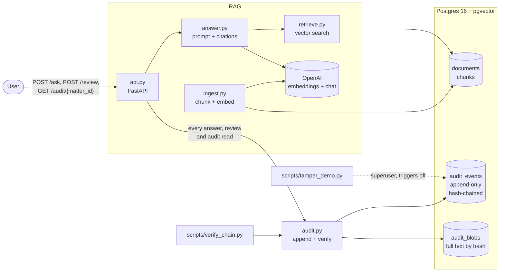
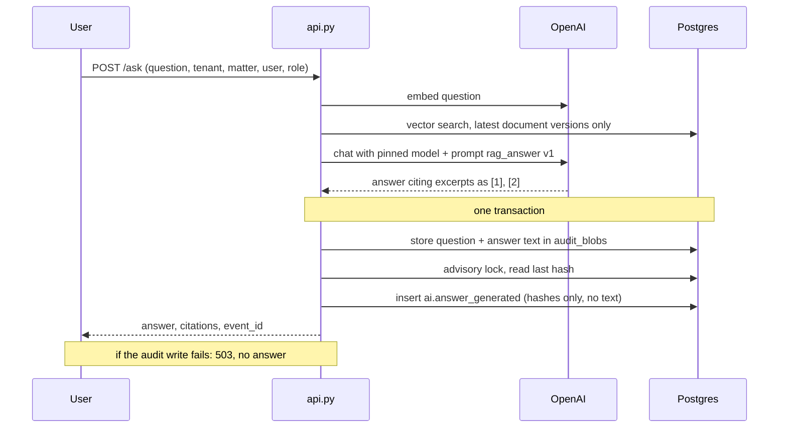
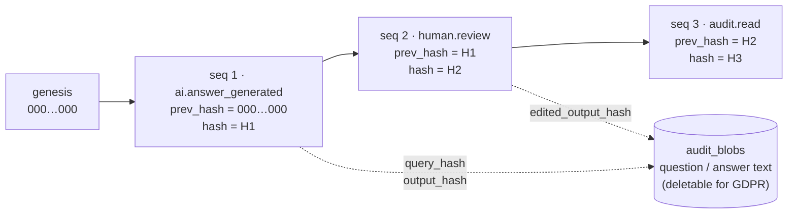

# Auditable RAG Demo

A small demo of how to make a retrieval-augmented generation (RAG) system **auditable** for legal and governance use. Any AI answer can be reconstructed later: what was asked, which document chunks were used, which model and prompt version produced it, what the user saw, and who reviewed it.

Audit records are append-only and **tamper-evident**: they form a hash chain, and a verifier script reports the first record that was changed, deleted or reordered.

This is a portfolio demo, not production software. See [SPEC.md](SPEC.md) for the specification and [Known limitations](#known-limitations) for what it doesn't cover.

## How it fits together



### What happens on `POST /ask`



### The hash chain

Each event stores the hash of the event before it, and its own hash covers that value plus all of its other columns:

```
hash = sha256(prev_hash || canonical_json(every column except hash))
```



Editing seq 2 means its recomputed hash no longer matches the hash stored with it. Deleting seq 2 leaves seq 3 pointing at a hash that isn't there anymore. Either way, the verifier stops and reports that `seq`.

## Quick start

Requirements: Docker (Desktop or another runtime), [uv](https://docs.astral.sh/uv/) and an OpenAI API key. uv installs Python 3.12 for you.

```bash
cp .env.example .env                  # then set OPENAI_API_KEY in .env
docker compose up -d --wait           # Postgres 16 + pgvector; applies sql/001_schema.sql on first start
uv sync                               # install dependencies
uv run python -m app.ingest           # embed the sample documents in data/sample_docs/
uv run uvicorn app.api:app            # API on http://127.0.0.1:8000 (docs at /docs)
```

The tests need neither an API key nor the running API: the embedding and chat calls are replaced by fakes. They use a separate database, `auditable_rag_test`, in the same container, rebuilt on every run, so they never touch the demo data.

```bash
uv run pytest
```

## Using the API

The examples below are from a real run against `gpt-4o-mini-2024-07-18`, with the fictional sample documents. Version 2 of the shareholder agreement changed the notice period from 30 to 45 days, and only the latest version is searched.

**Ask a question.** This writes one `ai.answer_generated` event. The optional `X-Trace-Id` header links the event to a trace in an observability tool.

```bash
curl -s -X POST localhost:8000/ask -H 'Content-Type: application/json' \
  -H 'X-Trace-Id: live-demo-1' \
  -d '{"question": "How much notice must a shareholder give before transferring shares, and who can buy them first?",
       "tenant_id": "acme-law", "matter_id": "M-2025-001", "user_id": "alice", "role": "associate"}'
```

```json
{
  "event_id": "4715c8d3-a17d-43f3-bc63-a80a272577cb",
  "trace_id": "live-demo-1",
  "answer": "A shareholder must give written notice of the proposed transfer at least 45 days before the transfer. The shares must first be offered to the other shareholders, who have the right of first refusal to buy them [1].",
  "citations": [
    {"marker": 1, "chunk_id": 9, "document_id": 3,
     "title": "Shareholders' Agreement of Halvard Robotics GmbH", "document_version": 2, "page": 2}
  ]
}
```

A question the documents don't cover ("What is the CEO salary?") gets the reply *"It can't be answered from the provided documents."* with no citations.

**Review the answer.** This writes a new `human.review` event, and the original answer event is never changed. `action` is `accepted`, `edited` (with `edited_answer`) or `rejected`.

```bash
curl -s -X POST localhost:8000/review -H 'Content-Type: application/json' \
  -d '{"event_id": "4715c8d3-a17d-43f3-bc63-a80a272577cb", "action": "edited",
       "edited_answer": "Written notice at least 45 days before the transfer (clause 3, v2 as amended 15 January 2025); the other shareholders have a right of first refusal (clause 4).",
       "user_id": "bob", "role": "partner"}'
```

**Read the audit trail for a matter.** This returns each answer with its question, model, prompt, cited chunks and reviews, plus a list of earlier reads. The read itself is logged as an `audit.read` event.

```bash
curl -s 'localhost:8000/audit/M-2025-001?tenant_id=acme-law&user_id=carol&role=compliance'
```

```json
{
  "tenant_id": "acme-law",
  "matter_id": "M-2025-001",
  "read_event_id": "f6adbd6b-0911-469f-bc06-b75614dd07d2",
  "answers": [
    {
      "event_id": "4715c8d3-a17d-43f3-bc63-a80a272577cb",
      "seq": 1,
      "actor_id": "alice",
      "question": "How much notice must a shareholder give before transferring shares, and who can buy them first?",
      "answer": "A shareholder must give written notice … [1].",
      "model": {"requested": "gpt-4o-mini-2024-07-18", "reported": "gpt-4o-mini-2024-07-18",
                "system_fingerprint": "fp_06e34e0f8b", "finish_reason": "stop",
                "params": {"temperature": 0, "max_completion_tokens": 600}, "called": true},
      "prompt": {"id": "rag_answer", "version": "v1", "hash": "853746f3…"},
      "cited_chunks": [{"chunk_id": 9, "document_id": 3, "document_version": 2, "page": 2,
                        "content_hash": "7d821924…", "score": 0.613786, "cited": true}],
      "reviews": [{"seq": 3, "actor_id": "bob", "action": "edited", "edited_answer": "Written notice …"}]
    }
  ],
  "reads": []
}
```

(The response is shortened here.) A text that was deleted for GDPR is returned as `null`, while its event and hashes stay.

## Verifying and tampering

To check the chain at any time (exit code 0 = OK, 1 = broken):

```bash
uv run python scripts/verify_chain.py
```

```
OK: 4 events verified
head: 4:36d0a296a568ebdda2364d00a3daf3974c6751e1819f935ff4a53def7919357f
```

Pass a saved head on later runs with `--expect-head 4:36d0…`. This is the only way to notice that the newest events were deleted (see [Known limitations](#known-limitations)).

To see tampering get caught, run the tamper demo:

```bash
uv run python scripts/tamper_demo.py --yes
```

It **permanently breaks the chain** in the database it targets, which is why it refuses to run without `--yes`. It shows that a normal UPDATE is refused, for `app_user` and even for the superuser. It then switches the triggers off as superuser, changes one event and verifies again:

```
2-3. Try a normal UPDATE of seq 2
  app_user: refused (InsufficientPrivilege: permission denied for table audit_events)
  superuser: refused (RaiseException: audit_events is append-only: UPDATE is not allowed)

4. Superuser switches triggers off and edits seq 2
  merged {"tampered_by_demo": true} into the payload

5. Verify again
BROKEN at seq 2: hash mismatch (event was modified)
```

To reset the demo database afterwards, then run ingest again:

```bash
docker compose down -v && docker compose up -d --wait && uv run python -m app.ingest
```

## What's in an answer event

Everything needed to explain an answer later, but no document text:

| Field | Why it's there |
|---|---|
| `query_hash`, `output_hash` | sha256 of the question and of the exact answer shown. The texts are in `audit_blobs`. |
| `model.requested`, `model.reported` | the pinned snapshot that was asked for, and the one OpenAI says it used |
| `model.system_fingerprint`, `model.params` | OpenAI's id for the backend setup, and the generation settings |
| `model.finish_reason` | `length` would mean the answer was cut off |
| `prompt.id`, `prompt.version`, `prompt.hash` | which prompt from the registry was used, with a hash of its full text |
| `embedding_model` | must match between documents and question, or retrieval quietly gets worse |
| `retrieval.chunks[]` | chunk id, document id, `document_version`, page, `content_hash`, score and `cited` for every retrieved chunk |
| `invalid_citation_markers` | markers such as `[9]` that match no chunk, recorded instead of quietly removed |

The exact messages sent to the model aren't stored, because they can be rebuilt. The prompt comes from the registry by version, and the chunk texts are looked up by id and checked against `content_hash`. A test does exactly this and compares the result with what was sent.

## Design decisions

**Audit logging is kept separate from observability.** Tools like LangSmith are built for debugging and improving the system. They sample, aggregate and expire data, and engineers can usually edit or delete it. An audit log has the opposite requirements: it must be complete, append-only, tamper-evident, kept for a defined retention period, and readable by compliance people, not just engineers. The two are linked only by a trace id (`X-Trace-Id`), so each system can do its job without weakening the other.

**Snapshot by hash, not just document id.** A document id says *which* document was used, not *what it said* at the time. Every chunk stores a `content_hash`, and the answer event records it for each retrieved chunk. Changed documents are ingested as a new version, never overwritten. Only the newest version is searched, but old chunks stay, so a past answer can still be traced to the exact text it was based on.

**Pinned model and prompt versions.** `app/config.py` pins a dated model snapshot (`gpt-4o-mini-2024-07-18`), not a moving alias like `gpt-4o-mini`, which can start pointing at a different model without notice. The event records both the requested model and the one OpenAI reports. Prompts live in a registry with an id, version and hash. A test fails if a prompt that's already in use is edited in place, so changes have to go in as a new version. One caveat: OpenAI publishes no dated snapshots of embedding models, so `text-embedding-3-small` is the most precise pin available.

**Reviews are new events.** A lawyer accepting, editing or rejecting an answer adds a `human.review` event pointing to the original's `event_id` and hash. The original is never updated, so the record shows both what the AI said and what the human did with it. Reading the audit trail is logged as an `audit.read` event on the same chain, which makes reads tamper-evident too.

**Texts stored separately, for GDPR.** Questions and answers can contain personal data, and an unchangeable chain must not hold anything that might have to be erased. So events only store the sha256 of each text, and the text itself lives in `audit_blobs`. Deleting a blob leaves every event, and the chain, intact. The verifier reports it as redacted, and the API returns `null`.

**Fail closed.** If the audit event can't be written, `/ask` returns 503 instead of an unaudited answer, and `/audit` returns 503 instead of an unlogged read. An answer and its texts are committed together or not at all.

**Auditable ≠ reproducible.** The log proves *what happened*: the inputs, the chunks used, the model and prompt, the exact output and the review. It doesn't promise that asking again gives the same answer. LLM output isn't fully deterministic even at temperature 0, and providers eventually retire model snapshots. That's why the exact output is stored instead of being regenerated.

## How tampering is prevented and detected

| Layer | Where | What it does |
|---|---|---|
| Least privilege | `sql/001_schema.sql` | The app connects as `app_user`, which may only `SELECT` and `INSERT` on the audit tables. It has no `UPDATE`, `DELETE` or `TRUNCATE`, and it can't delete stored texts. |
| Append-only triggers | `sql/001_schema.sql` | `UPDATE`, `DELETE` and `TRUNCATE` on `audit_events` raise an error, **even for the superuser**. Bypassing them takes a deliberate, superuser-only step. |
| Hash chain | `app/audit.py` | Canonical JSON (sorted keys, no whitespace), so hashes don't depend on how Postgres stores JSON. `seq` and `created_at` are inside the hash. |
| Safe concurrent appends | `app/audit.py` | A transaction-level advisory lock serializes "read last hash → insert", so parallel writers can't fork the chain. A test runs 20 parallel appends; without the lock, that test fails. |
| Verifier | `scripts/verify_chain.py` | Reports the first broken `seq`. It catches modified, deleted, reordered or renumbered events and modified texts. With `--expect-head`, it also catches deletion from the end of the chain. |

## Known limitations

- **Deletion from the end of the chain.** Deleting the newest events leaves a shorter chain that still verifies. Only a head (`seq:hash`) saved earlier reveals it, via `--expect-head`, and only if it was saved somewhere the attacker can't edit.
- **Whole-chain rewrite.** A superuser can change an event and recompute every later hash, after which the chain verifies again. Defending against this needs the head stored outside the database, e.g. in S3 Object Lock, as described below.
- **Hashes outlive redaction.** After a text is deleted, its hash remains. For short or guessable texts (like "yes"), someone could find the text by hashing candidates. A keyed hash (HMAC) per tenant would prevent this.
- **No authentication.** `user_id` and `role` are taken from the request as given. Anyone who knows an `event_id` can review that answer, and anyone can read any matter's audit trail.
- **Shared corpus.** Documents aren't scoped to a tenant or matter. `tenant_id` and `matter_id` only label audit events.
- **Failed attempts aren't logged.** If the model call fails, `/ask` returns 502 and writes no event. A stricter system might log failed attempts too.
- **No redaction tool.** Deleting a text for GDPR is a manual SQL step as the superuser: `DELETE FROM audit_blobs WHERE hash = '…'`. The tests show the chain stays valid afterwards.

## What would change for production

- **Export to write-once storage.** Ship events and chain heads to S3 Object Lock (compliance mode), so not even a database superuser can rewrite history unnoticed.
- **Scheduled verifier with alerting.** Run `verify_chain.py --expect-head <last stored head>` on a schedule, store the new head externally, and alert on failure. It already exits 1 on failure for this purpose.
- **Per-tenant encryption keys (crypto-shredding).** Encrypt blobs with a per-tenant or per-person key. Erasure then means destroying the key, which also covers backups and exports.
- **Access control per matter.** Real authentication, with retrieval and audit reads restricted to the matters a user is assigned to.

## Project layout

```
docker-compose.yml         Postgres 16 + pgvector
sql/001_schema.sql         tables, app_user role and grants, append-only triggers
app/config.py              database URLs, pinned models, prompt registry
app/db.py                  connection helper (autocommit; app_user by default)
app/audit.py               canonical JSON, hashing, append, verify
app/embeddings.py          OpenAI embedding client
app/ingest.py              parse, chunk, embed and store documents
app/retrieve.py            vector search over the latest document versions
app/answer.py              prompt, model call, citation mapping, audit fields
app/api.py                 FastAPI endpoints
scripts/verify_chain.py    verify the chain; exit 1 on failure
scripts/tamper_demo.py     break the chain on purpose, show detection
data/sample_docs/          fictional shareholder agreement (v1, v2) and NDA
tests/                     pytest suite with fake OpenAI clients and a separate test database
```
